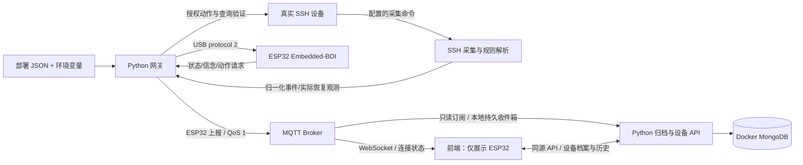

# 项目架构

ESP32 负责故障记忆、BDI 决策、有限重试、验证截止时间与恢复稳定窗口。
部署网关持续等待 USB：启动时未插硬件不会因等待 30 秒而退出，随后插入会自动握手。
运行中拔出后串口读取器继续重试，重新插入后恢复连接和快照同步。
SSH 登录、厂商命令、输出解析、凭据、TLS、持久化都在主机网关。
前端不访问 SSH 设备、不调用模拟器，只订阅配置的 ESP32 主题。
数据库服务首次发现同一主题根的新 ESP32 时自动注册，保存档案、最新快照与历史。
已移除的设备保留连接记录，同一次连接继续上报不重建档案；新 USB 连接或硬件启动
的实时状态会自动重新发现，也可手动添加。旧快照和后端重启不会恢复已移除设备。
数据库 API 启用时，前端每 5 秒通过 API 同步当前 USB 连接的档案、状态、计数和最近上报，
MQTT 不直接更新展示数据。实时计数按 USB 连接与硬件 boot 划分，来自 MongoDB，
刷新或后端重启不清零；独立历史页按设备和日期查询所有连接，历史默认长期保留。
未配置 API 的独立模式才直接展示 MQTT。MongoDB 断线不阻塞 BDI，
后端通过独立 SQLite 收件箱补写，细节见 [数据库指南](database.md)。
日志中的 `device=<target>` 是监测对象，不能解释为 ESP32 自身的健康状态。

## 模块边界

| 模块 | 职责 |
|---|---|
| `src/` | 固件与可在主机编译的同一份状态模型/Embedded-BDI |
| `esp_gateway/config.py` | 配置校验、路径、凭据环境变量、前端配置导出 |
| `esp_gateway/transport.py` | USB 握手/确认/重连、MQTT、队列、ESP32 上报路由 |
| `esp_gateway/store.py` | SQLite 快照、双向队列、动作账本与部署身份绑定 |
| `esp_backend/` | MQTT 持久收件箱、MongoDB 幂等归档、设备档案与历史 API |
| `esp_gateway/reports.py` | 持久化打包上报、快照与 USB 原文合并、正常限频与故障及时上报 |
| `esp_gateway/ssh.py` | host key 验证、shell/exec 会话、有界输出与规则解析 |
| `esp_gateway/runtime.py` | 每设备 SSH 采集、动作授权、执行与真实状态验证 |
| `esp_gateway/simulation.py`、`realistic_simulation.py` | 仅 demo 模式使用的演示源与延迟动作 |
| `config/` | 环境配置示例；真实配置使用忽略提交的 `local.json` |
| `frontend/` | 仪表盘/ESP32 输出控制台/历史查询；启动时加载运行时 JSON |
| `deploy/` | systemd、Web 反代、MQTT ACL、凭据文件模板 |
| `test/` | 验收；旧脚本保留兼容入口 |
| `productlines/` | 型号资料、原始样本和假设备测试工具 |

生产包不从 `test/` 导入代码。真实与模拟模式共享传输、持久化和协议，通过
配置选择采集适配器；真实模式禁止启用模拟器。

## 配置契约

| 配置 | 控制内容 |
|---|---|
| `mode` | `demo` 或 `ssh` |
| `agent` | ESP32 逻辑 ID、主题根、名称 |
| `serial` | USB 路径、波特率 |
| `storage` | 持久状态库，演示/生产及不同 Agent 不混用 |
| `protocol` | 新鲜度、ACK 等待、验证、稳定窗口，握手时下发固件 |
| `reporting` | 正常打包周期 `interval_ms`（默认 5000）与变化合并窗口 `batch_ms`（默认 250） |
| `mqtt` | 网关 Broker、账号、TLS、证书、客户端 ID |
| `web` | 浏览器 WebSocket、独立只读账号、ESP32 ID 列表 |
| `devices[].ssh` | 地址、认证、信任文件、超时、会话和提示符 |
| `devices[].checks` | 命令、告警/健康正则、部件、故障、级别与原因 |
| `devices[].actions` | 动作开关、目标白名单、命令模板；默认关闭 |

路径相对配置文件解析，凭据用 `*_env` 引用环境变量。缺配置、凭据、host key、
非法正则或不满足时间预算时，在访问设备前失败，不自动回退为模拟模式。

## 单包 MQTT 上报

配置入口使用 `<root>/<agent>/report`，不再分别发送 serial、status、observation、
event/action 副本。每包含 `schema_version=1`、唯一 `report_id`、`sent_at_ms`、
`boot`、最近一次实际 `status`、全部 `observations[]`、本批 `lines[{at_ms,text}]`。
USB 原文仅记录一次；网关自身诊断明确带 `[GATEWAY]` 前缀。

正常数据每 5 秒合并发送，状态改变/动作/恢复在 250 毫秒窗口后及时发送；单包
最多 64 行，连续突发会提前分包。待打包内容落 SQLite，打包与加入 MQTT 队列原子
提交，Broker 断线继续保留。USB RECEIPT、ACK 和执行器不等待 MQTT 打包。

每包携带完整最新快照，原始采样时间不更新为打包时间。前端只订阅 report 和
availability，每包只显示一条；QoS 重投按 report ID 去重，retained 只重建状态。
availability / Last Will 保持独立，以便断线立即生效，不进入日志刷屏。

## 恢复真实性

1. SSH 检查必须全部读取并识别成功，才发送新心跳；未知/歧义输出不当成正常。
2. `ACK OK` 表示执行器接收了任务，不表示设备已恢复。
3. 执行器只允许明确开启且在白名单中的动作；执行前重读实际状态，
   已恢复则不修改，变为物理断线则取消管理性修复。
4. 动作后重新查询，实际状态恢复才发送恢复观测；ESP32 稳定验证后才输出成功。
5. 动作在执行前落盘；重试/重启只验证已认领操作，不重复修改设备。
   执行中崩溃导致结果不确定时保留故障供运维核验，不宣称严格 exactly-once。
6. 每设备采集与动作提交串行化，避免旧采样覆盖刚完成的恢复。

固件安全边界：最多 32 台监测对象，USB 输入 511 字节，输出最多 8192 字节。
配置不能把一块 ESP32 扩成无限容量。
配置校验限制总检查数不超过 128，并预留重放帧空间，超限需拆分到其他 Agent。

## 支持范围

当前“改配置即可接入”指 SSH 命令/文本输出设备，以及已有 `UNLOCK` /
`RECOVER_INTERFACE` 动作。IP、账号、端口、命令、正则、部件、MQTT 地址和
时间参数变化不需要修改源码或重新编译。设备软件版本不同先用 `probe` 核验输出。

Comware 示例命令参考：[H3C R612x 命令参考](https://www.h3c.com/en/Support/Resource_Center/EN/Home/Switches/00-Public/Reference_Guides/Command_References/H3C_S5130S-SI_LI_S5120V2-SI_LI_CR-R612x-6W102/01/201909/1227853_294551_0.htm)。
Redfish、SNMP、Syslog、HDM 专用认证、全新动作或业务高可用仲裁需要相应适配器
与真实样本验收，不属于此次 SSH 配置接入范围。
