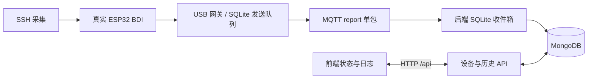

# MongoDB 与设备持久化

## 本地启动

需要 Docker Desktop 引擎已启动、Python 3.11+ 和 Node.js。仓库根目录执行：

```bash
python3 -m venv .venv
.venv/bin/python -m pip install -r test/requirements-integration.txt
npm --prefix frontend ci
.venv/bin/python deploy/init_mongodb_env.py
./deploy/dependencies.sh up -d --wait
.venv/bin/python test/live_demo.py start
```

也可以完成依赖安装后双击根目录的 `观看实时演示.command`。启动器会启动
Docker MongoDB、Docker Mosquitto、USB 网关、归档后端和前端；重复启动不会复制已运行的服务。
同时启动 mongo-express 数据库管理界面。统一 Compose 用法见 [Docker 依赖指南](docker.md)。
`test/live_demo.py stop` 停止主机服务，数据库由 Docker 保持运行。

| 服务 | 本地地址 |
|---|---|
| 仪表盘 | http://127.0.0.1:4173/ |
| 实时控制台 | http://127.0.0.1:4173/console.html |
| 历史查询 | http://127.0.0.1:4173/history.html |
| 后端健康检查 | http://127.0.0.1:8080/api/health |
| MongoDB | `127.0.0.1:27017`，数据库 `esp_diag` |
| 数据库管理 | http://127.0.0.1:8081/db/esp_diag |

MongoDB 使用 `mongo:8.0`，数据保存在 Docker 卷 `esp-diag_mongo_data`；容器重启、
重建保留数据。不要对需要保留数据的环境执行 `docker compose down -v`。
账号、密码、API token 在忽略提交的 `deploy/mongodb.env` 中，生成器只创建一次，
权限为 600，不覆盖已有值。客户端可用其中应用账号连接，认证数据库为 `esp_diag`。

## 浏览器管理数据库

已加入 `mongo-express` 容器，与 MongoDB 通过 Compose 内部网络连接。入口为
<http://127.0.0.1:8081/db/esp_diag>，可以浏览、查询、编辑文档，管理集合和导入导出数据。
`devices` 是 ESP32 档案与最新状态，`reports` 是历史打包上报。

登录用户名默认 `admin`，随机密码见本机 `deploy/mongo-express-login.txt`；
该文件只包含管理入口和网页登录信息，权限为 600，已忽略提交。
完整配置在 `deploy/mongodb.env` 的 `MONGO_EXPRESS_*` 项中；网页登录密码
与 MongoDB 应用密码独立。初始化脚本为旧环境补充管理配置，不改动已有数据库密码、
API token 或已有管理登录信息。

```bash
.venv/bin/python deploy/init_mongodb_env.py
docker compose --env-file deploy/mongodb.env up -d --wait mongo-express
docker compose --env-file deploy/mongodb.env logs -f mongo-express
.venv/bin/python test/mongo_express_acceptance.py
```

`MONGO_EXPRESS_PORT` 默认 `8081`。修改配置后运行上述初始化和启动命令，
Compose 会重建管理容器；MongoDB 数据卷保持不变。
管理界面使用现有业务库的 readWrite 应用账号，仅显示该数据库，未授予 MongoDB 根权限。
此入口用于本机实验管理，仅绑定 `127.0.0.1`，不由生产 Web 反代公开。
镜像固定为 `mongo-express:1.0.2-20-alpine3.19`。配置项参考
[mongo-express 项目文档](https://github.com/mongo-express/mongo-express-docker#configuration)。

## 数据流与保存内容



前端不访问模拟器、SSH 目标或 MongoDB。后端只订阅 ESP32 的 `report`、
`availability`，不发控制命令，不需要 SSH 密码或串口权限。

| 集合 | 内容 |
|---|---|
| `devices` | ESP32 自动注册、名称、位置、启用标记、最新完整快照、在线通知 |
| `reports` | 原始打包上报、USB 行、观测时间、接收时间、Agent ID |
| `agent_registrations` | 已发现的 ESP32 身份及最近连接；区分同一连接继续上报与重新接入 |

设备主键包含 `topic_root/agent_id`。报告按该主键与 `report_id` 幂等写入，
MQTT 重投、补写或后端重启不会产生重复历史。迟到报告仍保存历史，但不能覆盖
更新的快照；上报不会覆盖用户编辑的名称、位置等档案。

新 ESP32 第一次上报后自动注册，前端每 5 秒同步设备档案和归档计数。前端“添加设备”
只预建设备档案；新增 SSH 监测对象仍需在网关 `devices[]` 配置地址、凭据、命令，
检查通过后重启网关。数据库不自动扫描网络或下发 SSH 配置。
“启用”控制仪表盘监控统计，不停止网关采集。移除档案保留历史；已删除的 ESP32
不会被同一次 USB 连接的后续上报或后端重启重新注册。
重新插入硬件、重启硬件或重新建立网关 USB 连接后，新的实时状态会自动恢复档案；
也可在前端手动添加同一 ID。MQTT retained 快照和旧连接迟到报告不会触发恢复。
在 Mongo Express 直接删除 `devices` 文档也遵循此行为。仪表盘统计和两个页面的日志
仅显示当前设备档案对应的数据，移除后旧历史不再进入页面统计，但仍可在历史查询页或 `reports` 管理查看。
全新的 ESP32 ID 首次上报仍会自动发现。`agent_registrations` 不随历史 TTL 清理，
升级时会从现有档案与历史补齐身份和连接状态；不要把它当历史集合清空。

仪表盘和独立日志控制台默认展示当前 USB 连接的数据，每 5 秒核对数据库实际记录。
“实时上报”和设备消息计数按当前 USB 连接 ID 与硬件 boot ID 统计，刷新或后端重启
不归零；重新连接或硬件重新启动另起实时计数。日志显示当前连接最近 50 个上报包，
保留原始上报时间。旧连接的记录仍保存在历史中，不混入实时计数。

`/history.html` 是独立历史查询入口，默认查询最近 30 天，可点击“全部历史”，
或选择更早的日期、ESP32 ID；每页 50 包，支持上一页、下一页和展开 USB 原文。
历史查询也包含移除档案的设备和过去连接的数据，不受当前设备列表限制。
查询结束时间固定，翻页使用时间戳与唯一 ID 游标，相同时间戳的记录也不会漏页。

数据库 API 启用后，设备状态、计数和日志均以 MongoDB 为准，MQTT 不直接更新展示数据。
SQLite 只用于网关可靠队列、动作账本和后端待入库收件箱，不是历史查询或页面计数的数据源。
数据库暂不可用时保留当前计数和日志，显示提示并自动重试，不回退为零。
在管理界面删除 `reports` 后，下次同步会移除日志；最新状态退回当前连接最新的剩余记录，
记录为空时清空状态。设备缓存中的旧快照不会复活已删除记录。实际上报仍持续入库，
因此删除后可能马上看到新产生的记录。浏览器本地档案不会覆盖数据库信息。
编辑失败会明确提示，不会假装已保存。
未配置 `web.api_url` 的独立前端继续使用原有 localStorage 模式，不提供数据库历史查询。

历史默认长期保留，`ESP_HISTORY_DAYS=0`，30 天以前的数据仍可查询。
后端启动会清除该主题根已有记录的 `expires_at`，取消旧的 30 天到期时间；
已经被旧策略清理或手动删除的数据不能凭此恢复，需从备份还原。
若以后确实需要自动清理，可配置 1–3650 天，新写入报告会带 `expires_at`，
由 TTL 索引异步清理。正数保留期之间的修改仅影响之后新写入的报告。

## 数据库断线

后端先提交 SQLite 收件箱再确认 MQTT 消息，MongoDB 恢复后重放并去重。
USB BDI、动作与实时 MQTT 不等待 MongoDB。数据库不可用时档案 API 返回 503，
硬件采集和动作继续运行；页面保留上次成功读取的数据并提示异常，数据库恢复后自动同步。
收件箱默认 `var/backend/inbox.sqlite3`，容量 50,000 包；满或磁盘不可写会断开
订阅而不确认该包。长期离线能力还依赖 Broker 的持久会话、离线队列和磁盘配置。
后端启动时需要 MongoDB 可用；systemd 模板会在启动失败后重试。

```bash
docker compose --env-file deploy/mongodb.env ps
docker compose --env-file deploy/mongodb.env logs -f mongodb
tail -f test/.runtime/live-demo/backend.log
.venv/bin/python test/live_demo.py restart-backend
```

`GET /api/health` 返回 MongoDB/MQTT 连接情况、待写包数量和归档错误标记。

## 真实环境：仅改配置

网关继续使用 `config/local.json`；后端读取同一文件的 `agent` / `mqtt` 部分，
不读取或校验 SSH 登录信息。启动：

```bash
.venv/bin/python -m esp_backend --config config/local.json --env-file deploy/mongodb.env
```

- 本地 Docker 地址和应用凭据来自 `MONGO_HOST`、`MONGO_PORT`、`MONGO_DATABASE`、
  `MONGO_USERNAME`、`MONGO_PASSWORD`。
- 远程集群可设置 `MONGODB_URI`，支持驱动的 replica set、TLS 等连接参数；
  同时设置 `MONGO_DATABASE` 为实际业务库。此时 URI 的认证参数优先于分开的账号配置。
- 后端 MQTT 建议使用 `ESP_ARCHIVE_MQTT_USERNAME`、`ESP_ARCHIVE_MQTT_PASSWORD`
  覆盖网关账号，授予对应主题根的只读订阅权限，见 `deploy/mosquitto-acl.example`。
  MQTT TLS 证书路径仍相对 JSON 文件解析。
- `ESP_API_TOKEN` 需至少 32 字符，与导出前端配置时 `web.api_token_env` 引用的值一致。
  `web.api_url` 使用同源 `/api`，Vite 和 `deploy/Caddyfile` 已提供反代。
- 后端默认只监听 `127.0.0.1:8080`；可配置 `ESP_API_HOST`、`ESP_API_PORT`。
  Linux 持续运行模板见 `deploy/esp-backend.service`。同一主题根部署一个归档服务，
  不同实例需要独立 MQTT client ID 与 `ESP_BACKEND_STATE`。

前端导出文件包含浏览器 API token 和只读 MQTT 密码，授权浏览器用户可见；
不包含 MongoDB、SSH 或网关写账号凭据。生产 Web 入口需配置现场要求的访问认证和 TLS。
MongoDB Docker 仅绑定回环地址，根账号用于初始化管理，业务后端使用独立 readWrite 应用账号。
初始化脚本只在空数据卷执行，修改 env 文件不会重置已有 MongoDB 用户密码。

API 业务接口均需 `Authorization: Bearer <ESP_API_TOKEN>`：

- `GET /api/devices?scope=live`：当前连接的设备状态与计数；`scope=history` 查询全部历史计数。
- `PUT/DELETE /api/devices/{id}`：编辑或移除档案；PUT 只接受 `name`、`location`、`enabled`。
- `GET /api/reports?scope=history&agent=<id>&start_ms=<毫秒>&end_ms=<毫秒>&limit=50`：
  按设备、上报时间查询，筛选项均可省略；`scope=live` 仅查询已登记设备的当前连接。
  返回 `reports`、`total`、`next_cursor`、`scope`、`history_days`；下一页传回 `cursor`。
  单页上限 200 包。API 省略 scope 时保留历史查询语义，实时页面明确传 `scope=live`。

## 备份与验收

使用 MongoDB 的 `mongodump` / `mongorestore` 备份还原，凭据经容器环境读取；
示例在容器内生成备份，然后复制到主机：

```bash
docker compose --env-file deploy/mongodb.env exec mongodb sh -c 'mongodump --username "$MONGO_INITDB_ROOT_USERNAME" --password "$MONGO_INITDB_ROOT_PASSWORD" --authenticationDatabase admin --db "$MONGO_INITDB_DATABASE" --archive=/tmp/esp-diag.archive --gzip'
docker compose --env-file deploy/mongodb.env cp mongodb:/tmp/esp-diag.archive ./esp-diag.archive
.venv/bin/python -m unittest discover -s test -p 'test_*.py'
.venv/bin/python test/mongodb_acceptance.py
.venv/bin/python test/mongodb_live_history_acceptance.py
node --test frontend/test/*.test.js
```

验收只写随机的独立主题命名空间，结束清理测试记录，不删除业务数据库。
SQLite 队列与动作账本也需按原部署指南保留。
实时演示运行时可执行 `.venv/bin/python test/mongodb_outage_acceptance.py`，
该验收会短暂停止并重启本地 MongoDB，验证真实上报积压、恢复补写及卷内档案保留。

参考：[官方 Docker 镜像](https://hub.docker.com/_/mongo)、
[MongoDB TTL 索引](https://www.mongodb.com/docs/v8.0/core/index-ttl/)。
