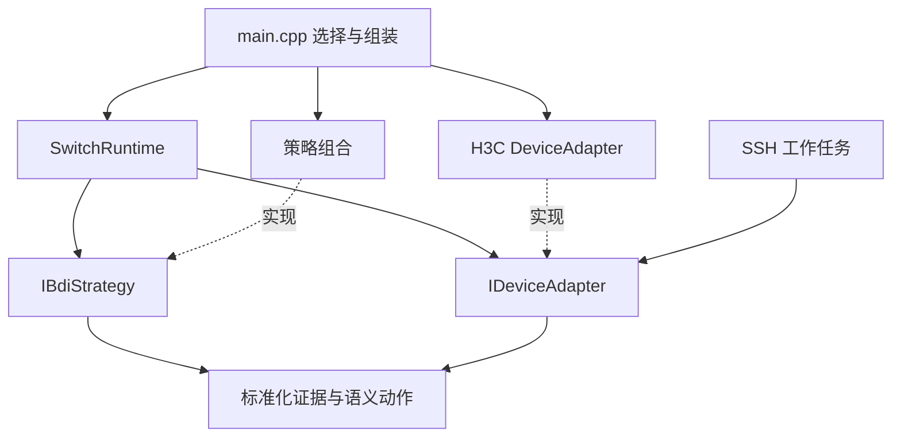

# 固件策略与设备适配开发结构

正式入口仍为 `src/main.cpp`。它在启动时选择设备适配器、组合策略并注入调度器。后台、前端和模型训练目录不参与固件业务依赖。

```text
src/
├── main.cpp                         组合入口：选择设备和策略
├── domain/
│   ├── switch_state.h               标准化证据、时间戳、端口标识
│   └── switch_policy.h              公共动作门控、语义动作、结果验证
├── bdi/
│   ├── strategy.h                   IBdiStrategy、固定容量 StrategySet
│   ├── heartbeat_strategy.h         IHeartbeatStrategy
│   └── strategies/
│       ├── heartbeat.h              SSH 登录后的 ICMP 心跳策略
│       ├── loop_discovery.h         多条件环路探索策略
│       └── loop_isolation.h         明确环路证据的隔离策略
├── application/
│   ├── switch_runtime.h             采集调度、策略调用、动作闭环
│   └── action_ledger.h              跨重启的持久意图与防重放
├── adapters/
│   ├── device_adapter.h             IDeviceAdapter
│   └── h3c/
│       ├── device_adapter.h         当前 H3C 型号/版本实现
│       ├── cli.h                    命令、提示符、错误、动作命令构造
│       ├── observations.h           五项核心表与版本解析
│       └── discovery_observations.h MAC 漂移与 CPU 解析
├── net/                             SSH/ICMP/MQTT 传输
├── config/site_policy.h             本现场已授权的业务端口范围
├── storage/                         TF、NVS
└── h3c/                             旧包含路径和类型名的兼容转发
```

## 依赖规则



业务策略不包含设备命令、不引用 H3C 解析器，也不持有 SSH。Runtime 不包含具体品牌或具体策略实现。SSH 工作任务通过同一个不可变适配器取得命令、提示符、会话设置和预期视图。适配器无可变状态，可被主循环与 SSH 任务读取。BDI 推理仍只在主循环运行。

## 编写一个策略

实现 `IBdiStrategy` 的以下契约：

| 接口 | 职责 |
| --- | --- |
| `id()` | 稳定且唯一的策略名称 |
| `reset()` | 切换目标或配置时清除本策略状态 |
| `disconnected()` | 默认重置；隔离策略保留事件防重放锁存 |
| `evaluate(observation, policy, now)` | 只读取本轮标准化证据和现场策略 |
| `phase()` | 默认 Observe；提出动作的策略选 ProposeAction |
| `proposal()` | 默认无动作；仅返回语义 ActionPlan，不能直接执行 |
| `json(now, maxAge)` | 可选状态输出，须处理证据过期 |

最小只读策略示例：

```cpp
class MyStrategy final : public switchbdi::IBdiStrategy {
public:
  const char* id() const override { return "my_observation"; }
  void reset() override {}
  void evaluate(const switchmodel::Observation& observation,
                const switchmodel::Policy& policy, uint64_t now) override {
    if (!switchmodel::usableSnapshot(observation.snapshot, now, policy.maxAgeMs))
      return;
    // 只使用标准化证据；在此更新信念、触发目标及运行本策略的 BDI 计划。
  }
};
```

在 `main.cpp` 创建策略对象并放入 `StrategySet`：

```cpp
switchbdi::LoopDiscoveryStrategy discovery;
switchbdi::LoopIsolationStrategy isolation;
switchbdi::StrategySet strategies{&discovery, &isolation};
switchapp::SwitchRuntime runtime{deviceAdapter, strategies, site::switchPolicy()};
```

组合最多八个策略，按注册顺序执行，先 Observe 后 ProposeAction。重复名称、重复对象、空指针构造组合会被拒绝或使组合无效；无效组合禁止动作。Runtime 构造后冻结注册，策略实例和适配器须比 Runtime 存活更久。策略持有自己的历史和 EmbeddedBDI 实例，不能共享未隔离的跨设备状态。

心跳输入来自异步 Ping 回调，不能等待十条 SSH 命令的一整轮。因此使用单独的 `IHeartbeatStrategy` 输入接口（reset/tick/observe/probeError/state），在入口注入 `SwitchHeartbeat`；具体实现集中在同一个 `bdi/strategies/` 目录。原告警阈值、首次登录门控和恢复规则保持。

## 更换设备

实现 `IDeviceAdapter`，然后在 `main.cpp` 把适配器同时注入 `SwitchRuntime` 和 `SwitchSsh`。不需要修改通用环路策略。

| 设备接口 | 要实现的内容 |
| --- | --- |
| `id()` | 型号/版本配置标识 |
| `queryCount()/queryAt()` | 该设备的查询顺序和项目；调度器不假定十项或版本必须排第一 |
| `readCommand(key)` | 内部查询名称到固定只读命令的映射，未知项目返回 nullptr |
| `accept(...)` | 解析返回并填充 Observation；身份须匹配已验证型号/版本 |
| `canonicalPort(...)` | 本机端口名称到公共物理端口 ID 的转换 |
| `actionCommands(...)` | 从语义动作和校验后的端口生成命令，拒绝不支持的动作 |
| `actionPrompts(...)` | 每一步动作完成后必须匹配的预期终端视图 |
| `prompt()/userPrompt()/failed()` | 设备终端边界与错误识别 |
| `sessionSetup()` | 关闭分页等固定只读会话设置 |
| `hostKeyAlgorithms()` | 必要的设备签名兼容设置，默认使用 SSH 库默认值 |

标准模型保留现有物理端口 ID 格式（如 GigabitEthernet1/0/2），以维持 NVS 意图账本、管理口保护和已有页面数据的兼容。其他品牌适配器应显式映射本机名称，并在生成命令时反向映射；不能直接把远端字符串拼入 CLI。接口类型 A/T/H、STP 角色和保护状态也须映射到公共模型的语义。超出当前端口模型的设备应先扩展契约和迁移测试。

授权属于现场 `site_policy.h` 与已确认的管理路径，设备适配器不授予自动动作权限。更换品牌前须核对端口映射、现场允许范围、管理口和型号身份，再做原始返回回放及实机验收。目前生产适配器只有已验证的 H3C S5130S-52S-EI / R6328P03；测试适配器不代表已支持另一品牌。设备选择目前在组合入口完成，不提供运行中热切换。

## 执行与兼容边界

策略输出 ActionPlan 只含动作类型、端口、证据轮次和目标版本，不再携带 CLI。CLI 由设备适配器唯一构造。Runtime 对每个建议独立复核当前证据、轮次、管理口、允许端口、STP/聚合保护；只有现有 Isolate 动作可以进入正式执行链。随后持久化意图、交给单一 SSH 任务、检查每步视图，再以新证据验证。扩展新的写动作必须同时实现公共授权与结果验证，不能仅增加一条策略或一串命令。

每轮首次查询成功入队后清空采集证据，保留目标版本，防止适配器漏填时重用上一轮数据。每项只按真实命令完成时间打戳。探索状态仍可展示上一完整轮判断，超过有效期则为 unknown。现有 `bdi.discovery` 字段保持，并增加 `bdi.device_profile` 和 `bdi.strategy_ids`。

旧 `src/h3c/` 只转发到新实现；`net/ssh_commands.h` 保留固定 H3C 测试/旧调用的兼容工具，正式 SSH 不使用该固定映射。旧 NVS 记录头 `ESP-H3C-CLAIM-1` 与键算法保持不变，避免升级清空动作认领；它是存储格式版本，不是新运行层的品牌依赖。板载小模型仍按现有 H3C 日志语料工作；新增品牌时需单独适配日志筛选、来源标注和模型效果，不能把设备接口可替换等同于模型已支持新品牌。

## 验证

```sh
.venv/bin/python -m unittest test.test_strategy_composition test.test_h3c_bdi_policy test.test_loop_discovery test.test_device_services test.test_heartbeat_bdi -v
PLATFORMIO_CORE_DIR="$PWD/.pio-core" /Users/robin/.platformio/penv/bin/pio run
```

替换测试使用两条查询、版本最后读取、show 命令和 # 终端提示符的测试适配器，通过相同 Runtime 和真实 SSH worker 验证。还覆盖替换策略、重复组合拒绝、坏策略提出动作被公共门控阻止、漏填证据不会沿用旧轮，以及原 H3C 实机样本、信任、隔离事务与读回回归。原生测试启用 ASan/UBSan；模拟不作为新品牌或 r5 的实机运行验收。
