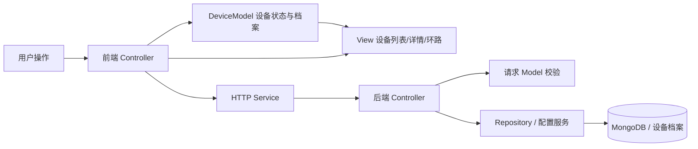

# 设备管理 MVC

设备管理采用明确的 Model / View / Controller 分层，HTTP 与数据库访问另外放在服务和仓储中。
正式固件的真实 H3C 采集、BDI 时序、处置和 MQTT 发布都在 ESP；后台和网页 View 不承担硬件执行。USB 协议与旧主机网关仅保留为实验兼容。

## 代码位置

| 层 | 位置 | 职责 |
|---|---|---|
| 入口 | `frontend/backend/app.js` | 加载样式，启动控制器 |
| Model | `frontend/backend/models/device-model.js` | 设备状态、档案字段、连接 ID 与业务编号；无 DOM、HTTP、浏览器存储 |
| View | `frontend/backend/views/dashboard-view.js` | 根据传入状态呈现列表、指标、详情与事件；不请求数据或保存档案 |
| View | `frontend/backend/views/loop-view.js`、`html.js` | 环路视图、格式化与 HTML 转义 |
| Controller | `frontend/backend/controllers/dashboard-controller.js` | 绑定事件，协调 MQTT、归档同步、表单提交、模型与视图 |
| Service | `frontend/backend/services/registry-service.js` | 同源 HTTP API 与错误处理；无 DOM |
| 后端入口 | `esp_backend/api.py` | 应用生命周期、认证、错误映射与路由装配 |
| 后端 Model | `esp_backend/models/` | 设备档案及上报间隔的输入结构与校验 |
| 后端 Controller | `esp_backend/controllers/devices.py`、`reports.py` | 设备管理、上报配置、历史查询路由；协调模型和仓储 |
| Repository | `esp_backend/repository.py` | MongoDB 持久化、唯一索引、按设备/连接统计及归档查询 |

`frontend/backend/registry.js` 与后端 `api.py` 的模型导入保留兼容入口。独立实时控制台、历史页
沿用现有页面入口并复用 HTTP Service 与协议模块；本次不要求它们复制设备管理控制器。

## 设备编号

- **连接 ID**（`id` / MQTT Agent ID）绑定设备上报、会话和历史。编辑档案不修改它。
- **设备编号**（`device_number`）供现场管理，例如 `ESP-001`，可设置、修改和清空。
  支持 0–32 位英文字母、数字、`.`、`_`、`-`；编号区分大小写。
- 同一主题根下，非空设备编号唯一。MongoDB 唯一索引处理并发重复，API 返回 409，页面提示换号。
- 未编号设备兼容旧数据，界面显示“未设置”。清空时移除该字段，允许多台设备暂不编号。
- 旧 API 客户端省略编号时保留原编号；显式传 `"device_number":""` 清空。上报不能覆盖编号。
- 编号保存在设备档案中；修改编号不会新建连接、改 MQTT 主题、合并计数或迁移历史。

操作入口：设备列表的编号或铅笔按钮 → 编辑设备 → 设备编号 → 保存。
编号同时显示在设备详情及独立实时控制台。

## 扩展管理功能

新增档案字段时，先修改后端输入 Model 与 Repository，再增加前端 Model 字段及 View 输入/展示；
复用现有 Controller 的保存流程。新增管理动作时，在 `controllers/` 增加独立控制器/路由，
需要远程调用就扩展 Service；View 仅负责收集输入和显示结果。正式硬件执行权限及故障恢复证据
仍由 ESP 固件处理，不根据网页按钮成功推断设备恢复。

验证覆盖：两台设备计数隔离、编号编辑后连接 ID 不变、页面刷新恢复、重复编号拦截、
旧客户端兼容、清空/复用编号、数据库重连持久化、历史和上报间隔接口回归、环路 View 独立渲染。

设备页面源文件在 `frontend/device/`，只调用 ESP 同源接口；后台控制台在 `frontend/backend/`，通过只读 MQTT 或 HTTP 消费状态和证据。两者共用 `frontend/shared/report-analysis.js`、`report-ai-view.js` 与纯规则模块，不共享控制器、凭据或硬件执行器。生成页面位于 `src/generated/`。

正式原生报告由 ESP 的 `src/storage/` 保存并发布，后台 `esp_backend/native_contract.py` 保留 uptime、boot 和原文，外层归档时间独立保存；设备列表使用 telemetry 的实际接收时间，retained 重收不刷新在线。数据库日志分类在 `esp_backend/log_ai.py` 与 `controllers/reports.py`；可选 `ai_provider.py` / `controllers/ai.py` 默认 disabled，仅提供附加解释。ESP 本机推理在 `src/ai/`，不依赖后台 provider。

历史数据库镜像流仍保留：Repository 读取已入库原文，`esp_gateway/archive_copy.py` 复制到 SD；`src/legacy/sd_database_mirror.h` 负责有界分片、校验和循环，`src/legacy/archive_frame.h` 仅解析旧协议。该路径不进入默认正式入口。
